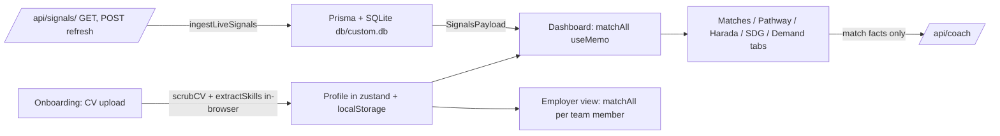

# Repository Guidelines

## Project Overview

**SkillCast** — "a weather forecast for your career in the AI era" — is a Next.js POC for the Aiversecity Future-Ready Workforce / UN SDG "Survive AI" (Domain 1) challenge. It ingests live job postings, computes per-skill "momentum" (a Skill Momentum Index), matches a user profile to future roles with explainable scores, builds a Duolingo-style reskilling pathway from curated courses, and maps roles to SDG targets.

Key design decisions (see `worklog.md`):
- **Deterministic core + LLM narration only**: all scoring/matching math is published, deterministic, client-side; the GLM LLM only writes match narrative and always falls back to a deterministic template.
- **Synthetic data only** (competition rule): profiles, team, CV are fabricated; live signals come from Remotive + Arbeitnow with curated fallback sources.
- Single-task POC scope; verification is a manual agent-browser golden path (screenshots in `scripts/verify-*.png`).

## Architecture & Data Flow

The app is SPA-shaped: `src/app/page.tsx` is the only `'use client'` root and switches five views (`landing | onboarding | dashboard | employer | signals`) from the zustand store. Everything in `src/app` and `src/components` is a client component except `layout.tsx` and the three API routes.



Data flow details:
- **Profile**: onboarding scrubs the CV in-browser (`scrubCV`); the de-identified text is POSTed to `/api/extract-cv` (self-hosted Qwen on RunPod, strict JSON extraction) with deterministic `extractSkills` as the fallback — raw CV never leaves the browser, only skill levels persist. Zustand `persist` under key `skillcast-poc`; `partialize` excludes transient `view`/`dashTab`.
- **Signals**: `SignalsProvider` (`src/components/skillcast/shared.tsx`) fetches `/api/signals` once on mount; `refresh()` POSTs. The route ingests live postings (15 s per-source timeouts, per-source try/catch), persists a `SignalRun` + `SignalSnapshot`s, diffs against the previous run to write a `ChangelogEntry` (movers `|Δ| ≥ 2`), guards against re-ingest within 10 minutes, and falls back to `seedSnapshots()` if all live sources fail. **This is the only code path touching Prisma.**
- **Matching** runs client-side with no AI: `matchAll(profile, momentumMap)` in a `useMemo`; results passed down as props to tab components. `momentumMap` (skillSlug → 0–100) comes from the signals context.
- **Coach**: `MatchCard` POSTs deterministic match facts (never CV text) to `/api/coach`; on any failure the route returns `fallbackNarration` and the UI shows `fallback: true` with disclosure copy.

## Key Directories

| Path | Purpose |
|---|---|
| `src/app/` | `page.tsx` (root view switcher), `layout.tsx` (only server layout), API routes `api/signals/`, `api/coach/`, `api/extract-cv/` |
| `src/components/skillcast/` | One named-export screen per file: `Landing`, `Onboarding`, `Dashboard`, `Employer`, `SignalsView`, plus `shared.tsx` (contexts, `useT`) and `header.tsx` |
| `src/components/ui/` | shadcn/ui catalog (≈40 Radix-based components) — add any new primitives here |
| `src/lib/` | Engines: `types.ts`, `matching.ts`, `momentum.ts`, `cv.ts`, `i18n.ts`, `store.ts`, `db.ts`, `utils.ts` |
| `src/data/` | Static datasets: `skills.ts` (40-skill taxonomy), `roles.ts` (16 roles), `courses.ts` (24 courses), `team.ts`, `curated.ts` (fallback signals + live sources), `sample-cv.ts` |
| `src/hooks/` | `use-mobile.ts`, `use-toast.ts` |
| `prisma/` | `schema.prisma` — SQLite `SignalRun` / `SignalSnapshot` / `ChangelogEntry` models |
| `db/` | Local SQLite file `custom.db` (runtime DB) |
| `mini-services/` | Reserved for standalone micro-apps (currently empty; each subdir = own package.json) |
| `tests/` | Shell scripts exercising the build-tooling pipeline (not app logic) |
| `scripts/` | Golden-path verification screenshots `verify-01…10-*.png` |
| `examples/websocket/` | Docs/demo of the Caddy `XTransformPort` mechanic |

## Development Commands

Package manager and runtime is **Bun** (`bun.lock`; only lockfile present — `npm start` will fail).

```bash
bun install
bun run dev          # next dev -p 3000 (Caddyfile proxies :81 → 3000)
bun run build        # next build + copies static/ and public/ into .next/standalone/
bun run start        # NODE_ENV=production bun .next/standalone/server.js
bun run lint         # eslint . (flat config)
bun run db:push      # prisma db push --accept-data-loss
bun run db:generate  # prisma generate
bun run db:migrate   # prisma migrate dev
bun run db:reset     # prisma migrate reset
```

Shell tests (run manually with `bash`):
- `tests/database-runtime-build.sh`, `tests/python-runtime-build.sh` — exercise deployment build tooling; `tests/python-runtime-container.sh` additionally needs Docker.

## Code Conventions & Common Patterns

- **Components**: shadcn/ui style (new-york, `rsc: true`), Radix primitives + Tailwind; `cn()` from `src/lib/utils.ts`. Screens are named exports in `src/components/skillcast/`, all `'use client'`. Styling via Tailwind (v3-style CSS-var theme in `tailwind.config.ts`, `darkMode: "class"`, `--c1..5` chart colors).
- **Aliases**: `@/*` → `./src/*` (`components.json`: `ui: @/components/ui`, `utils: @/lib/utils`, `lib: @/lib`, `hooks: @/hooks`). Use `@/lib/...` imports, not relative paths.
- **Types**: everything in `src/lib/types.ts` (`Profile`, `RoleDef`, `CourseDef`, `SignalsPayload`, `RoleMatch`, `GapItem`, `MatchFactor`, `Lang`, `ScenarioId`, `PathType`, …). Data modules export both a flat list and a `*_MAP` (e.g. `SKILLS` + `SKILL_MAP`).
- **State management**: zustand (`useSkillCast` in `src/lib/store.ts`) for app view + profile; `useSyncExternalStore` hydration guard on the root. Server state (signals) via a single React context, not a query lib.
- **Error handling**: per-source `try/catch` with graceful fallbacks (signals → `seedSnapshots`, coach → `fallbackNarration`); the UI always renders a deterministic result rather than an error boundary. No throw-heavy flows.
- **i18n**: lightweight custom system in `src/lib/i18n.ts` — `makeT(lang)` returns `(key, vars?) => string` with `{var}` interpolation; consumed via the `useT()` hook in `shared.tsx`. Locales: en, bm (Bahasa Malaysia), zh, ru. (next-intl is a dependency but the app does not use it.)
- **Deterministic formulas are invariants**: matching `FORMULA` in `src/lib/matching.ts` (0.40 overlap + 0.30 transferable + 0.20 experience + 0.10 interest) and `SMI_WEIGHTS` in `src/lib/momentum.ts` (0.5 frequency / 0.3 trend / 0.2 research horizon) are published, user-facing numbers — changing them changes product guarantees and the explainability copy.
- **Signals payload shape** is the cross-cutting contract: `SignalsPayload` with per-skill `SkillSnapshot` (`frequency`, `trend`, `momentum`, `postings`…); match and UI code both consume it.

## Important Files

- `src/app/page.tsx` — root view switcher + hydration guard
- `src/app/api/signals/route.ts` — live ingest → Prisma pipeline (only Prisma consumer)
- `src/app/api/coach/route.ts` — GLM narration with deterministic fallback
- `src/app/api/extract-cv/route.ts` — AI-assisted CV extraction (self-hosted Qwen on RunPod, strict JSON; deterministic fallback)
- `src/lib/matching.ts` — `FORMULA`, `matchRole`, `matchAll`, `haradaMatrix`, pathway duration math
- `src/lib/momentum.ts` — `SMI_WEIGHTS`, `ingestLiveSignals`, `computeMomentum`, `seedSnapshots`
- `src/lib/store.ts` — zustand store, `EMPTY_PROFILE`, `PERSONAS`, `INTERESTS`, `View`
- `src/lib/i18n.ts` / `src/lib/cv.ts` — translations; `scrubCV` / `extractSkills`
- `prisma/schema.prisma` + `src/lib/db.ts` — SQLite schema; globalThis-cached Prisma singleton
- `next.config.ts` — `output: "standalone"`, `typescript.ignoreBuildErrors: true`, `reactStrictMode: false`

## Runtime/Tooling Preferences

- **Bun is required** (runtime + package manager); only `bun.lock` exists. `next start`/standalone server is launched via `bun`.
- **Node/TS**: TypeScript with `noImplicitAny: false`; `next.config.ts` ignores build type errors, so `bun run lint` is the only enforced static check. ESLint flat config is deliberately permissive (disables `no-explicit-any`, `no-unused-vars`, `react-hooks/exhaustive-deps`, `no-console`).
- **Env**: `DATABASE_URL` (SQLite file URL) is the only var. **Gotcha**: `.env` points at the Linux sandbox path `file:/home/z/my-project/db/custom.db` — invalid on Windows; the real local DB is `db/custom.db`, so override `DATABASE_URL` (e.g. `DATABASE_URL=file:./db/custom.db`) when running locally.
- **Caddyfile**: dev proxy on `:81` → `localhost:3000`; `?XTransformPort=N` forwards to `localhost:N` (see `examples/websocket/`). Never put a port in the URL path when going through Caddy.
- `next build` only yields a runnable artifact via the script's extra `cp` steps (static + public into standalone).

## Testing & QA

- **No JS/TS test framework exists** (no vitest/jest/playwright, no `*.test.*`, no `"test"` script). Do not assume one; `bun run lint` is the only automated gate.
- The only automated tests are three manual `bash tests/*.sh` scripts covering **deployment build tooling** (DB copy/push, Python-runtime packaging, Docker import) — not application logic.
- **Established QA workflow**: manual golden-path E2E via agent-browser with screenshots saved to `scripts/verify-*.png` (landing → onboarding/CV scrub → dashboard → matches/coach → pathway → Harada → SDG → demand → email, plus bm/zh/ru locales, scenarios, employer view, signals refresh, mobile viewport). Follow this for feature verification; `worklog.md` tracks the canonical run.
- Coverage expectations are undocumented; application logic currently has zero automated coverage.